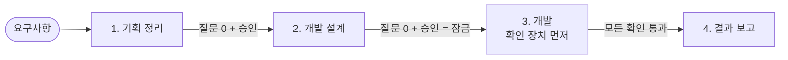

<div align="center">

# yw-forge

**요구사항 한 줄에서 테스트로 검증된 개발까지. `/yw` 하나로 순서대로.**

사람과 질문이 0개가 될 때까지 기획 · 설계를 정하고, 확인 장치를 먼저 만든 뒤 개발한다.
모든 문서는 프로젝트 안 `specs/`에 남고, 개발자와 비개발자가 같이 읽는다.


[설계서](docs/설계서.md) · [작성 규칙](rules/작성-규칙.md)

</div>

---

> **지금 상태**: 설계를 확정하는 중이다. 이전 버전(HTML 기획서 파이프라인, v0.9)은 지웠고, 새 파이프라인은 설계서 15장 순서대로 만든다. 아직 쓸 수 있는 명령은 없다.

## 흐름



| 원칙 | 뜻 |
|---|---|
| 요구사항 밖은 하지 않는다 | 사람이 말하지 않은 기능은 기획에도 코드에도 없다 |
| 질문 0 | 애매한 것은 모두 질문이 되고, 사람이 답하거나 "개발하지 않음"으로 정해야 넘어간다. 보류는 없다 |
| 그림으로 보여 준다 | 흐름 · 상태 · 갈래는 그림으로, 물을 때도 그림과 표로 |
| 설계가 먼저다 | 설계가 잠기기 전에는 코드를 쓰지 않고, 테스트가 코드보다 먼저다 |

## 명령

| 명령 | 하는 일 |
|---|---|
| `/yw <요구사항 또는 자료 경로>` | 시작 |
| `/yw` | 멈춘 곳에서 이어서 |
| `/yw status` | 진행 상황 |
| `/yw change <바꿀 내용>` | 승인된 기획 · 설계 변경 |
| `/yw ship` | 미리보기 배포, 실제 배포는 추가 승인 |

## 설치 (첫 배포 뒤)

```text
/plugin marketplace add YeongWon2/yw-forge
/plugin install yw-forge@yw-forge
```

## 배포

`main`에 push되면 GitHub Actions가 테스트를 돌리고, 플러그인 파일이 바뀐 커밋이 있으면 `plugin.json` 버전을 올리고 `CHANGELOG.md` · 태그 · GitHub Release를 만든다. 설치한 쪽은 `claude plugin update yw-forge@yw-forge` 뒤 `/reload-plugins`로 받는다.
