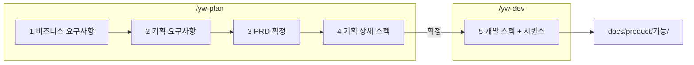

<div align="center">

# product-planning

**기획은 사람의 말로, 개발 스펙은 코드로 알 수 없는 것만. AI가 자동으로 쓰지 않고 원문을 인용해 묻고 같이 쓴다.**


[설계서](docs/design.md) · [비즈니스 요구사항](docs/brief-guide.md) · [기획](docs/planning-guide.md) · [기획 상세 스펙](docs/spec-guide.md) · [개발 스펙](docs/dev-guide.md) · [다이어그램](docs/diagram-guide.md) · [하네스](docs/harness.md)

</div>

---

## 왜 필요한가

| 흔한 증상 | 결과 |
|---|---|
| 기획과 개발 스펙이 한 문서에 섞여 있다 | 비개발자도 개발자도 읽기 어렵다 |
| AI가 흐름과 설계를 자동으로 만든다 | 사람이 원한 것과 다른 내용이 그럴듯하게 채워진다 |
| 요구사항이 어느 사업 목표에서 나왔는지 없다 | 우선순위를 정할 근거가 없다 |
| 상태·권한·수정 여부에 따른 분기가 빠진다 | "잠긴 글이면 이 단추는요?"를 개발 중에 묻는다 |
| 개발 결정이 코드에만 남는다 | 왜 이렇게 나눴는지, 무엇을 버렸는지 아무도 모른다 |

## 무엇을 만드나

대상 프로젝트의 `docs/product/{기능}/`에 그 기능의 기준 문서 네 개를 남긴다. 문서끼리 번호로 링크된다.

| 문서 | 읽는 사람 | 담는 것 |
|---|---|---|
| `prd.md` 기획 PRD | 비개발자 | 왜 지금, 목표·지표, 비즈니스 요구사항, 페르소나, 요구사항·완성 기준, 범위 밖 |
| `spec.md` 기획 상세 스펙 | 기획자·개발자 | 상태표, 조건표, 피쳐·함수 분기 트리 |
| `dev.md` 개발 스펙 | 개발자 | 결정, 아키텍처, 데이터, 계약, 오류, 제약, 작업, 검증, 프로젝트 규칙 대조 |
| `diagram.md` 시퀀스 다이어그램 | 개발자 | 계약마다 Mermaid 시퀀스 |

작업하는 동안은 프로젝트 밖 `~/.product-planning/work/{기능}/`에 작업 파일을 두고, 확정한 결과물만 프로젝트에 남긴다.
GitHub Spec Kit, Kiro, OpenSpec의 생각(빈칸은 묻기, 근거 사슬, 우선순위, 결정 기록, 프로젝트 규칙 대조)을 따랐다.

## 설치

Claude Code에서 마켓플레이스를 추가하고 플러그인을 설치한다.

```text
/plugin marketplace add YeongWon2/product-planning
/plugin install product-planning@product-planning
```

설치하면 `/yw-plan`, `/yw-dev` 두 명령이 생긴다. 하네스는 Node 20 이상이 필요하다.

## 어떻게 쓰나



1. `/yw-plan 기획하고 싶은 것 한 줄`로 시작한다. 사업 담당자 인터뷰부터 기획 상세 스펙까지 이어서 묻는다.
2. 기획이 확정되면 "개발 스펙으로 넘어갈까요?"를 묻는다. `/yw-dev {기능}`으로 따로 시작해도 된다.
3. `/yw-dev`는 기획이 없거나 확정 전이면 기획부터 진행한다.
4. 모든 질문은 어느 문서 어느 줄에서 나왔는지 원문을 그대로 붙여 묻는다.
5. 하네스가 `완료`를 내면 네 문서를 프로젝트에 내보낸다. 다음에 고칠 때는 결과물을 다시 읽어 와 고친다.

```text
근거  기획 상세 스펙 › F1 › ? 수정 권한이 있는가 › **아니오**
원문  "→ [수정] 단추가 보이지 않는다"
질문  권한은 화면과 서버 중 어디서 확인하나요?
```

## 하네스 보고

```text
단계  개발 › 5-4. 계약
완성도  R1 3/3 · 전체 100%
추가되어야 완성
1. [안 물어봄] "F1 › … › [수정] 누름 → 수정 모달이 열린다"를 인용한 계약이나 결정이 없다.
다음  트리의 사용자 행동을 원문을 인용해 무엇을 보내고 성공·실패 때 무엇을 받는지 묻는다.
```

```bash
node scripts/pp.mjs check examples/post-edit
```

## 구성

| 위치 | 내용 |
|---|---|
| `skills/yw-plan/` | 기획 1~4단계를 이끄는 스킬 |
| `skills/yw-dev/` | 개발 스펙과 시퀀스 다이어그램을 이끄는 스킬 |
| `scripts/pp.mjs` | 하네스 CLI (`init`, `check`, `sheet`, `quotes`, `export`, `import`, `discard`) |
| `src/` | 문서 읽기, 규칙, 대조, 출처, 링크, 보고, 내보내기 |
| `examples/post-edit/` | 네 문서 끝까지 통과한 예시 |
| `docs/` | 설계서와 작성법. 레포 문서는 200줄 이하 |

## 개발

```bash
npm test
```

의존성이 없고 Node 20 이상에서 돈다. 바뀐 내용은 [CHANGELOG](CHANGELOG.md)에 있다.

문제나 제안은 [이슈](https://github.com/YeongWon2/product-planning/issues)로 남긴다.
