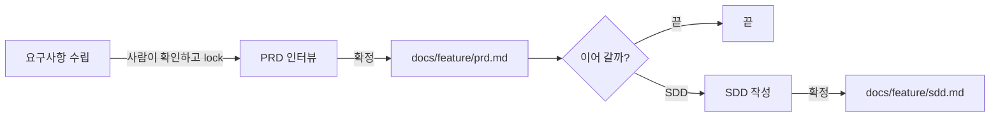

<div align="center">

# product-planning

**요구사항은 사람이 세우고, PRD와 SDD는 인터뷰로 같이 쓴다.**


[설계서](docs/design.md) · [기획 작성법](docs/planning-guide.md) · [SDD 스펙 작성법](docs/sdd-guide.md) · [하네스](docs/harness.md)

</div>

---

## 한눈에



| 단계 | 하는 일 | 남는 것 |
|---|---|---|
| 1. 요구사항 수립 | 누가, 무엇을, 왜, 무엇이 되면 완성인지 정하고 잠근다 | PRD 안에 들어간다 |
| 2. PRD 인터뷰 | 요약, 배경, 목표, 요구사항별 정책·예외를 묻고 답한다 | `docs/{feature}/prd.md` |
| 3. SDD 작성 | 상태·권한 조건마다 유저 플로우를 분기 트리로 쓴다 | `docs/{feature}/sdd.md` |

## 설치

```text
/plugin marketplace add YeongWon2/product-planning
/plugin install product-planning@product-planning
```

`/yw-plan`, `/yw-sdd` 두 명령이 생긴다. 하네스는 Node 20 이상이 필요하다.

## 사용법

1. 프로젝트 저장소에서 `/yw-plan 기획하고 싶은 것 한 줄`을 입력한다.
2. 입력창 질문에 답하며 요구사항을 세운다. 다 되면 "잠가 주세요"라고 한다.
3. 이어지는 PRD 인터뷰에 답하고 확정한다. 문서 폴더(기본 `docs`)에 `{feature}/prd.md`가 생긴다.
4. 여기서 끝내거나, SDD로 넘어가 `docs/{feature}/sdd.md`까지 만든다.

```text
<프로젝트>/docs/post-edit/
├─ prd.md   비개발자도 읽는 PRD
└─ sdd.md   개발자가 보는 SDD 스펙 (맨 위에 PRD 링크, 기호 없이 문장으로)
```

## 왜 이렇게 하나

| 흔한 문제 | 여기서는 |
|---|---|
| AI가 요구사항을 지어내 부풀린다 | 요구사항은 사람만 넣고, 잠근 뒤 바뀌면 하네스가 막는다 |
| 문서가 AI가 쓴 티가 난다 | 상투어, 번역투, 꾸밈, 존댓말을 하네스가 줄마다 잡는다 |
| 문서가 길어 아무도 안 읽는다 | 요약 3줄, 배경 5줄, 정책 7줄 상한. 요구사항은 표로 먼저 보여 준다 |
| "잠긴 글이면 이 단추는요?"를 개발 중에 묻는다 | SDD가 상태·권한 조건마다 모든 갈래를 쓰게 한다 |
| 다 됐는지 사람마다 다르다 | 완성 기준마다 SDD 트리의 근거 줄을 세어 완성도를 낸다 |

## PRD 모양

```md
# 게시글 수정 PRD

작성자: 영원 · 작성일: 2026-10-19

## 요약        한 줄씩 목록
## 배경        한 줄씩 목록
## 목표        표: ID · 목표 · 확인 방법
## 페르소나    ### P1 이름 → 원하는 것 · 행동 패턴 목록
## 용어        표: 용어 · 뜻
## 요구사항

| ID | 요구사항 | 누구 | 우선순위 |
|---|---|---|---|
| R1 | 작성자는 올린 글을 고칠 수 있다 | P1 글을 자주 올리는 작성자 | 꼭 |

### R1 작성자는 올린 글을 고칠 수 있다
왜 한 줄 → #### 완성 기준 → #### 정책 → #### 예외(표: 상황 · 처리)

## 범위 밖
## 지켜야 할 조건
```

P는 페르소나, R은 요구사항, R1-1은 R1의 완성 기준, G는 목표 번호다. 전체는 [예시 작업 파일](examples/post-edit/plan.md)에서 볼 수 있다.

## SDD 트리 모양

```md
## 피쳐 · 게시글 수정 · R1

- [게시글 상세] 진입
- ? 수정 권한이 있는가
  - **아니오**
    - → [수정] 단추가 보이지 않는다
  - **예**
    - ◆ 게시글 상태
      - **게시됨**
        - [수정] 누름 → 수정 모달이 열린다
      - **잠김**
        - → [수정] 단추가 비활성이다
```

| 표시 | 뜻 |
|---|---|
| `?` | 조건 분기 (권한 같은 조건표의 조건) |
| `◆` | 상태 분기 (상태표의 모든 상태) |
| `→` | 화면 결과 |
| `⇒ 앞 → 뒤` | 상태 전이 |
| `↪` | 함수 호출 |

## 하네스

```bash
node scripts/pp.mjs check examples/post-edit
```

예시는 끝까지 통과해 `단계  완료`가 나온다. 정책에 AI 말투가 섞이면 이렇게 막는다.

```text
단계  PRD › 6. 정책
완성도  PRD 확정 전
추가되어야 완성
1. [AI 말투] "다양한 글을 원활하게 고친다."에서 다양한, 원활 같은 말을 빼고 무엇이 어떻게 되는지 그대로 쓴다. (plan.md 38줄)
다음  요구사항마다 어떤 규칙으로 동작하는지, 예외는 무엇인지 묻는다.
```

명령과 단계 판정은 [하네스](docs/harness.md)에 있다.

## 개발

```bash
npm test
```

의존성이 없다. 바뀐 내용은 [CHANGELOG](CHANGELOG.md)에, 문제나 제안은 [이슈](https://github.com/YeongWon2/product-planning/issues)에 남긴다.
