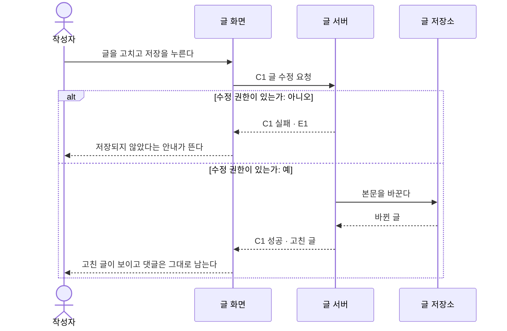

# 시퀀스 다이어그램 작성법

> 개발 단계 5-5다. 개발 스펙의 계약마다, 누가 누구를 어떤 순서로 부르는지 Mermaid 시퀀스 다이어그램으로 그린다.
> 참여자는 개발 스펙 아키텍처 표의 구성 요소(`A`)이고, 갈래는 기획 상세 스펙 조건표의 갈래다.
> AI는 자동으로 그리지 않는다. 계약과 흐름를 인용해 순서를 묻고, 개발자가 답한 순서만 옮긴다.

---

## 1. 그리는 순서

| 순서 | 사람이 하는 일 | AI가 하는 일 | 끝나는 조건 |
|---|---|---|---|
| 1. 시퀀스 나누기 | 계약을 어떤 시퀀스로 묶을지 정한다 | 흐름의 유스케이스 하나를 인용해 "이 흐름에서 부르는 계약은 무엇인가요?"를 묻는다 | 모든 `C`가 어느 `S`에 들어갔다 |
| 2. 순서 | 호출과 응답의 순서를 답한다 | 계약의 `호출:`을 인용해 먼저 부르는 쪽을 묻는다 | 메시지가 처음부터 응답까지 이어진다 |
| 3. 갈래 | 조건마다 각 갈래에서 무엇이 오가는지 답한다 | 조건표의 갈래를 인용해 빠진 갈래를 묻는다 | `alt`에 갈래가 다 나왔다 |
| 4. 확인 | 그림을 읽고 맞다고 한다 | 하네스 검사를 돌린다 | 검사 결과가 0건이다 |

질문 예:

```text
근거  개발 스펙 › C1 글 수정 요청
원문  "실패: E1"
질문  권한이 없을 때 A2는 A3까지 가지 않고 바로 돌려주나요?
```

---

## 2. 파일 모양

작업 파일과 결과 파일 모두 `diagram.md`다. 시퀀스마다 제목, 그림, 근거 줄을 둔다.

````md
# 게시글 수정 시퀀스 다이어그램

상태: 작성중

## S1 · 게시글 저장



계약: C1 · 흐름: F1 › 기본 흐름 › 3. 사용자가 글을 고치고 저장을 누른다
````

결과물에서는 상태 줄이 빠지고, 근거 줄의 번호가 개발 스펙과 기획 상세 스펙으로 가는 링크가 된다.
Mermaid 코드 블록 안에는 링크를 넣을 수 없으므로 링크는 근거 줄에만 둔다.

---

## 3. 줄 표기

| 표기 | 뜻 | 쓰는 법 |
|---|---|---|
| `actor P숫자 as 이름` | 사람 | PRD의 페르소나 번호를 쓴다 |
| `participant A숫자 as 이름` | 구성 요소 | 아키텍처 표의 번호와 이름을 그대로 쓴다 |
| `->>` | 부름 | 계약이면 메시지를 `C숫자 이름`으로 시작한다 |
| `-->>` | 돌려줌 | 계약 응답이면 `C숫자 성공` 또는 `C숫자 실패 · E숫자`로 쓴다 |
| `alt 조건: 갈래` / `else 조건: 갈래` | 조건 분기 | 조건표의 조건과 갈래를 그대로 쓴다 |
| `P숫자`에게 돌아오는 줄 | 화면 결과 | 흐름의 화면 결과 단계 문장이나 오류의 `보이는 것:`을 그대로 쓴다 |
| `계약:` `흐름:` 줄 | 근거 | 그림 바로 아래에 둔다 |

`loop`, `par`, `opt`도 쓸 수 있지만, `alt`와 합쳐 중첩은 3단계까지만 쓴다.

---

## 4. 검사 규칙

| 규칙 | 걸리는 경우 |
|---|---|
| 없는 참여자 | `participant`가 아키텍처 표에 없는 `A`이거나 이름이 다르다 |
| 없는 계약 | 메시지의 `C`가 개발 스펙 계약에 없다 |
| 다른 호출 방향 | 부름은 계약의 `호출:`과 같은 방향, 돌려줌은 그 반대 방향이 아니다 |
| 없는 실패 | `C숫자 실패 · E숫자`의 `E`가 계약의 `실패:`에 없다 |
| 빠진 갈래 | `alt`·`else`에 조건표의 그 조건 갈래가 다 나오지 않았다 |
| 없는 조건 | `alt`의 조건이 조건표에 없다 |
| 다른 결과 문장 | 사람에게 돌아오는 줄이 흐름의 화면 결과 단계 문장이나 오류의 보이는 것과 다르다 (끝 마침표는 보지 않는다) |
| 없는 의존 | 계약이 아닌 부름(`->>`)인데 받는 쪽이 보내는 쪽의 `기대는 곳`에 없다 |
| 근거 줄 없음 | 그림 아래 `계약:`이나 `흐름:` 줄이 없다 |
| 그림 없는 계약 | 어느 시퀀스에도 나오지 않는 `C`가 있다 |
| 너무 깊은 그림 | `alt` `loop` `par` `opt` 중첩이 3단계를 넘는다 |
| 그려지지 않음 | 위 줄 표기로 읽지 못한 줄이 있거나 묶음이 `end`로 닫히지 않았다 |

하네스는 Mermaid 전체를 그려 보지 않고 위 표기만 읽는다. 표기 밖의 줄은 그려지더라도 걸린다.
