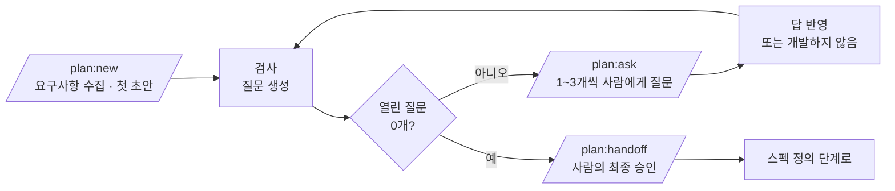

# 기획물 플러그인 설계서 (v2 초안)

> 작성일 2026-10-04 · 상태: **합의 중** (구현 전)
> 기존 `docs/설계서.md`(HTML 파이프라인, v0.9)를 대체할 새 방향이다. 구현이 이 문서를 따라잡으면 기존 설계서를 정리한다.
> 작성 규칙은 `docs/v2-작성-규칙.md`에 따로 둔다.

---

## 0. 한 장 요약

| 항목 | 내용 |
|---|---|
| 만드는 것 | 어떤 프로젝트에서 불러도 같은 형식의 **기획물(Markdown)** 을 만드는 범용 Claude Code 플러그인 |
| 입력 | 사람이 말한 요구사항과 사람이 준 자료뿐 |
| 출력 | 사용자 프로젝트 안 `planning/` 폴더에 **통합본 1개 + 기능별로 쪼갠 문서 여러 개** |
| 진행 방식 | 명령어로 단계를 진행한다. AI가 질문지를 만들고, 사람이 답하고, **열린 질문이 0이 될 때까지** 반복한다 |
| 끝 | 사람이 최종 승인하면 **스펙 정의 단계**로 핸드오프한다 |
| 범위 밖 | 스펙 정의(상태 코드값 · API · 데이터 구조 · 컴포넌트), 비주얼 디자인, 코드 생성 |

---

## 1. 원칙

| # | 원칙 | 지키는 방식 |
|---|---|---|
| P1 | **요구사항 밖은 절대 하지 않는다** | 사람이 말하거나 준 자료에 없는 기능 · 화면 · 알림은 넣지도, 제안하지도 않는다. 문서의 모든 문장은 요구사항 하나 이상으로 거슬러 올라갈 수 있어야 한다 |
| P2 | **모호함 0** | 해석이 둘로 갈리는 문장은 질문이 된다. 열린 질문이 0이어야 핸드오프할 수 있다 |
| P3 | **AI의 가정도 질문이다** | AI가 근거 없이 채운 사실은 문서에 넣지 않고 질문지로 보낸다 |
| P4 | **완전하게, 읽기 쉽게** | 요구사항마다 정해진 항목(5장)이 빈칸 없이 채워진다 |
| P5 | **비개발자와 개발자가 같이 읽는다** | `docs/v2-작성-규칙.md`를 따른다. 기술 용어와 상태 코드값은 쓰지 않는다 |
| P6 | **사람만 결정한다** | 질문을 닫는 것, 핸드오프를 승인하는 것은 사람만 한다. AI는 질문과 추천안을 낼 뿐이다 |

---

## 2. 질문을 닫는 규칙

질문은 **사람이 승인했을 때만** 닫힌다. 닫는 방법은 두 가지뿐이다.

| 닫는 방법 | 뜻 | 문서에 생기는 일 |
|---|---|---|
| **답 승인** | 사람이 선택지 하나를 고르거나 직접 답을 주고, 반영 결과를 승인함 | 영향 문서에 반영하고 `decisions.md`에 기록 |
| **개발하지 않음** | 사람이 그 내용을 이번 기획에서 뺀다고 결정함 | 관련 요구사항 · 기능 · 문장을 문서에서 빼고, `decisions.md`와 핸드오프 문서의 **개발하지 않는 것** 목록에 남김 |

- **보류는 없다.** "나중에 정하자", "일단 넘어가자"는 닫힘이 아니다. 정하지 못하면 그 내용은 **개발하지 않음**으로 닫는다.
- AI는 질문을 닫을 수 없다. AI가 답을 추천해도 사람이 승인하기 전까지 질문은 열려 있다.

---

## 3. 진행 흐름



- 답을 반영하면 새 질문이 생길 수 있으므로 매 바퀴 다시 검사한다.
- 한 바퀴를 돌았는데 열린 질문 수가 줄지 않으면 멈추고, 막힌 질문과 이유를 사람에게 보고한다.
- `/plan:handoff`는 열린 질문이 1개라도 있으면 실행하지 않고 남은 질문만 보여 준다.
- 최종 승인 단계에서 사람이 고칠 곳을 말하면 그것도 질문으로 등록되어 루프로 돌아간다.

---

## 4. 명령어

| 명령 | 하는 일 | 사람이 하는 일 |
|---|---|---|
| `/plan:init` | 현재 프로젝트에 `planning/`과 `config.json` 생성 | 문서 언어, 서비스 · 앱 구성 확인 |
| `/plan:new <요구사항>` | 기능 폴더 생성, 요구사항 수집, 첫 초안과 첫 질문지 생성 | 요구사항 목록 확인 |
| `/plan:ask` | 열린 질문을 우선순위대로 1~3개씩 묻고, 답을 반영한 뒤 재검사 | 답하기 / 개발하지 않음 결정 / 반영 결과 승인 |
| `/plan:status` | 열린 · 닫힌 질문 수, 단계, 개발하지 않는 것 목록 | 없음 |
| `/plan:handoff` | 열린 질문 0일 때만 실행. 최종 확인 후 핸드오프 문서 생성 | 최종 승인 |

질문 우선순위: 착수를 막는 질문 → 다른 질문을 많이 만드는 질문(상위 개념) → 나머지.

---

## 5. 문서가 담는 것 (요구사항마다 빈칸 없이)

| 항목 | 내용 |
|---|---|
| 접근 조건 | 누가, 어디서, 어떤 조건일 때 이 기능을 쓸 수 있나 |
| 상태 · 권한에 따른 동작 | 입력 칸(형식 · 필수 · 범위 · 안내 문구), 상태와 권한에 따라 달라지는 것 |
| 에러 · 빈 화면 | 입력 오류, 빈 목록, 권한 없음, 불러오기 실패 |
| 완료 조건 | 무엇이 보이면 기능이 끝난 것인가 |
| 성공 · 실패 시 동작 | 팝업 · 토스트 · 화면 이동 · 다른 앱에 생기는 일 |
| 테스트 케이스 | 정상 · 권한 · 상태 · 입력 · 에러 · 실패 · 취소 |
| 유저 플로우 | 갈래가 있는 기능에만 mermaid로 |

프로젝트 공통으로는 배경, 목표 지표, 용어, 상태와 계산 규칙(일상어로), 권한표, 공통 문구, 엣지 케이스 전체를 담는다.

**상태 코드값은 쓰지 않는다.** 상태는 '진행 전 · 진행 중 · 완료'처럼 일상어로만 적고, 코드값은 스펙 정의 단계에서 정한다. 핸드오프 문서에 "스펙 정의에서 코드값을 정할 상태 목록"을 넘긴다.

---

## 6. 폴더 구조

### 6.1 플러그인 레포

```
product-planning/
├─ .claude-plugin/          plugin.json · marketplace.json
├─ commands/                plan-init.md · plan-new.md · plan-ask.md · plan-status.md · plan-handoff.md
├─ skills/planning-core/    SKILL.md   ← P1~P6, 질문 방식, 작성 규칙 요약
├─ templates/               통합본 · 기능 · 목차 · 질문지 · 결정 · 핸드오프 템플릿
├─ scripts/                 문서 검사(빈 항목 · 금지어 · 모호어 · 용어집 · 링크), 통합본 합치기
└─ docs/                    설계서 · 작성 규칙
```

### 6.2 사용자 프로젝트 (`/plan:init` 실행 결과)

```
<프로젝트>/planning/
├─ config.json              문서 언어 · 서비스 · 앱 구성
├─ README.md                기능 목록 · 단계 · 열린 질문 수
├─ _shared/                 용어집 · 공통 문구 · 권한 체계 · 시스템 구성
└─ <기능>/
    ├─ <기능>-기획서.md      통합본 (쪼갠 문서를 합친 것)
    ├─ 00-목차.md            쪼갠 문서 지도 + 요구사항 → 기능 → 테스트 추적표
    ├─ 01-배경-요구사항.md
    ├─ 02-목표-지표.md
    ├─ 03-상태-규칙/         개체별 상태와 계산 규칙 (일상어)
    ├─ 04-권한.md            누가 · 어떤 상태에서 · 무엇을 할 수 있나
    ├─ 05-기능/<앱>/NN-<기능>.md
    ├─ 06-화면-흐름.md
    ├─ 07-엣지케이스.md
    ├─ questions.md          질문지 (열림 · 닫힘 모두)
    ├─ decisions.md          사람이 내린 결정 기록
    ├─ handoff.md            핸드오프 문서 (승인 후 생성)
    └─ .state.json           현재 단계 · 질문 수
```

---

## 7. 질문지 형식

```markdown
### Q-012 · 열림 · 착수 막음
- 질문: '완료' 상태의 과제를 코치가 수정할 수 있나요?
- 선택지: 1. 불가 (추천: 완료 뒤 기록이 바뀌지 않게) / 2. 허용 / 3. 개발하지 않음
- 생긴 이유: 권한표 빈칸 (과제 · 수정 · 완료)
- 영향 문서: 04-권한.md, 05-기능/코치웹/07-과제-수정.md
- 결과: —   · 승인한 사람: —   · 날짜: —
```

질문이 생기는 곳:

| 출처 | 예 |
|---|---|
| 빈칸 | 권한표 칸, 실패 시 동작, 빈 화면 문구가 비어 있음 |
| 모순 | 두 자료 또는 두 섹션이 서로 다르게 말함 |
| 가정 | AI가 근거 없이 채우려던 사실 |
| 모호한 문장 | 모호어, 범위 없는 숫자, 둘로 읽히는 문장 |
| 요구사항 해석 | 요구사항 문장이 어디까지 포함하는지 불분명함 |

"요청 밖 내용을 넣을까요?" 같은 질문은 만들지 않는다 (P1).

---

## 8. 정할 것 (다음 논의)

- `config.json` 항목과 `/plan:init`이 묻는 것
- `/plan:new`의 요구사항 수집 방식 (말로 받기 / 자료 읽기 / 둘 다)
- 검사 스크립트가 잡는 항목의 정확한 목록
- 통합본과 쪼갠 문서의 원본 관계 (쪼갠 문서가 원본이고 통합본은 합친 결과인지)
- 기존 HTML 파이프라인 코드(`src/`, `scripts/spec.mjs`)를 어떻게 정리할지
