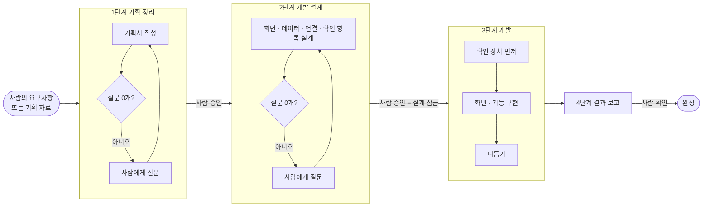
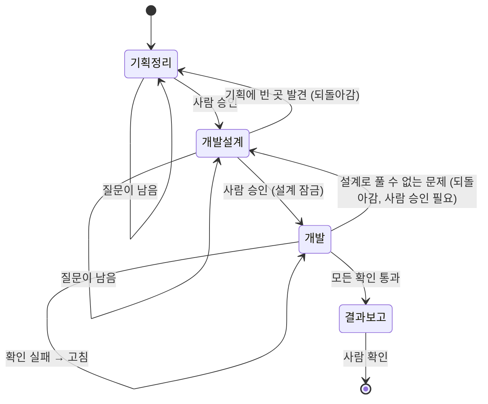
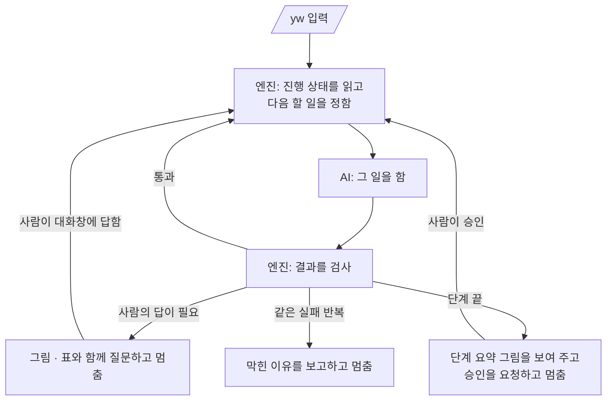
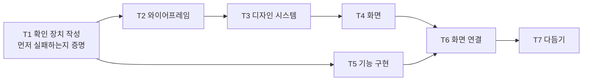
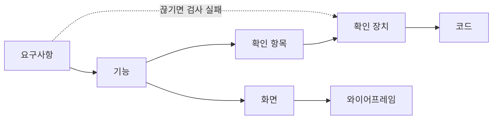

# yw-forge 설계서

> 작성일 2026-10-04 · 상태: **합의 중** (구현은 슬라이스 0 · 1부터)
> 이 문서는 플러그인을 **어떻게 만들지**가 아니라 **무엇을 어떤 순서로 하고, 무엇으로 품질을 보장하는지**를 정한다.
> 개발자와 비개발자가 함께 읽는다. 기술 단어는 처음 나올 때 괄호 안에 한 줄로 풀이한다.
> 작성 규칙: `rules/작성-규칙.md`

---

## 0. 한 장 요약



| 항목 | 내용 |
|---|---|
| 무엇인가 | 요구사항에서 시작해 **기획 → 개발 설계 → 개발 → 결과 보고**까지 이어 가는 Claude Code 플러그인 |
| 명령 | 평소에는 **`/yw` 하나**. 멈춘 곳에서 이어서 진행한다. 보조 명령은 `/yw status` · `/yw change` · `/yw ship` |
| 사람이 하는 일 | 질문에 답하기, 단계마다 승인하기. 그 밖의 일은 플러그인이 순서대로 한다 |
| 품질을 보장하는 방법 | 질문 0개가 되어야 다음 단계로 간다. 단계마다 프로그램(엔진)이 검사한다. 하면 안 되는 일은 물리적으로 막는다 |
| 남는 것 | 모든 문서는 그 프로젝트 폴더(`specs/`)에 남는다. 외부 도구로 옮기지 않는다 |
| 하지 않는 것 | 요구사항에 없는 기능 추가, 사람 대신 결정하기 |

---

## 1. 원칙

| # | 원칙 | 지키는 방법 |
|---|---|---|
| P1 | **요구사항 밖은 절대 하지 않는다** | 모든 문장과 코드는 요구사항 하나 이상으로 거슬러 올라가야 한다(추적, 10장). 거슬러 올라가지 못하면 검사에서 떨어진다 |
| P2 | **모호함 0** | 해석이 둘로 갈리는 문장은 질문이 된다. 열린 질문이 0이어야 다음 단계로 간다 |
| P3 | **AI의 추측도 질문이다** | 근거 없는 사실은 문서에 넣지 않고 질문지로 보낸다 |
| P4 | **빠짐없이, 읽기 쉽게** | 문서 종류마다 정해진 항목이 빈칸 없이 채워져야 한다 |
| P5 | **개발자와 비개발자가 같이 읽는다** | `rules/작성-규칙.md`. 기술 단어는 풀이를 붙이고, 코드값과 기호는 "개발 참고" 칸에만 둔다 |
| P6 | **사람만 결정한다** | 질문을 닫는 것과 단계를 승인하는 것은 사람만 한다 |
| P7 | **그림으로 보여 준다** | 흐름 · 상태 · 갈래 · 연결은 그림으로 그린다. 사람에게 물을 때도 그림이나 표로 보여 준다 (5장) |
| P8 | **설계가 먼저다** | 설계가 잠기기 전에는 코드를 한 줄도 쓰지 않는다. 확인 장치(테스트)가 코드보다 먼저다 |
| P9 | **부르지 않으면 움직이지 않는다** | 명령을 치지 않으면 아무것도 동작하지 않는다. 대화 중에 알아서 켜지는 기능이 없다 |

---

## 2. 단계

### 2.1 단계 한눈에 보기

| 단계 | 하는 일 | 끝나는 조건 | 남는 문서 (`specs/<기능>/`) |
|---|---|---|---|
| 1. 기획 정리 | 요구사항을 모아 사람이 읽는 기획서를 쓴다 | 검사 통과 + 질문 0 + 사람 승인 | `source/`, `product/`, 기획서 통합본 |
| 2. 개발 설계 | 기획서를 화면 설계 · 개발 설계 · 확인 항목으로 옮긴다 | 검사 통과 + 질문 0 + 사람 승인 → **설계 잠금** | `design/`, `code/`, `test/`, 설계 통합본 |
| 3. 개발 | 확인 장치를 먼저 만들고, 그걸 통과하도록 구현하고, 다듬는다 | 모든 확인 통과 + 품질 기준 통과 | 실제 코드, 확인 장치, 검사 증거 |
| 4. 결과 보고 | 무엇을 만들었고 어떻게 확인했는지 보고한다 | 사람 확인 | `.yw/runs/<회차>/report.md` |
| 변경 | 이미 승인된 기획 · 설계를 바꾼다 (`/yw change`) | 영향받은 부분만 다시 1~4단계 | 바뀐 문서 + 결정 기록 |
| 배포 | 미리보기 배포, 사람 승인 뒤 실제 배포 (`/yw ship`) | 미리보기 확인 통과 | 배포 기록 |

> SDD 설계서의 단계 이름과의 대응: 1단계 = Phase A + Phase B의 제품 스펙, 2단계 = Phase B의 화면 · 개발 · 확인 스펙, 3단계 = Phase C, 4단계 = Phase D, 배포 = Phase E, 변경 = Phase F.

### 2.2 단계 사이의 문



- **되돌아가기**: 뒤 단계에서 앞 단계의 빈 곳을 발견하면 질문을 만들고 앞 단계로 돌아간다. 앞 단계 문서가 바뀌면 그 뒤 단계 중 영향받은 부분만 다시 한다.
- **설계 잠금**: 2단계 승인 때 설계 문서의 지문(내용 해시: 내용이 한 글자라도 바뀌면 달라지는 값)을 저장한다. 3단계에서 설계가 바뀌면 엔진이 멈춘다.

---

## 3. `/yw` 진행기

### 3.1 동작



| 언제 | 사람의 입력 | 일어나는 일 |
|---|---|---|
| 처음 | `/yw <요구사항 문장 또는 자료 경로>` | 프로젝트를 준비하고 1단계를 시작한다 |
| 이어서 | `/yw` | 저장된 진행 상태에서 다음 할 일부터 한다 |
| 질문을 받았을 때 | 대화창에 답 | 답을 반영하고 이어서 진행한다 |
| 승인 요청을 받았을 때 | "승인" 또는 고칠 점 | 승인이면 다음 단계, 고칠 점이면 질문으로 등록하고 이어서 진행 |

### 3.2 멈추는 경우는 셋뿐이다

1. 열린 질문이 있다.
2. 단계가 끝나 승인이 필요하다.
3. 같은 실패가 반복되어 스스로 고칠 수 없다 (11장).

그 밖에는 멈추지 않고 다음 일로 넘어간다. 세션이 끊기면 다음에 `/yw`를 치면 이어서 한다.

### 3.3 누가 무엇을 하나

| 겹 | 맡는 일 | 판단을 하나 |
|---|---|---|
| 엔진 (프로그램) | 다음 할 일 정하기, 검사, 추적, 진행 상태 저장, 허용되지 않은 쓰기 막기 | 하지 않는다. 같은 입력이면 언제나 같은 결과 |
| AI (에이전트) | 문서 쓰기, 질문 만들기, 설계, 구현 | 한다. 대신 엔진 검사를 통과해야 한다 |
| 사람 | 답하기, 승인하기 | 최종 결정 |

---

## 4. 질문지와 결정

### 4.1 질문을 닫는 규칙

질문은 **사람이 승인했을 때만** 닫힌다. 닫는 방법은 두 가지뿐이고, **보류는 없다**.

| 닫는 방법 | 뜻 | 문서에 생기는 일 |
|---|---|---|
| 답 승인 | 사람이 선택지를 고르거나 직접 답함 | 영향 문서에 반영하고 `decisions.md`에 기록 |
| 개발하지 않음 | 사람이 그 내용을 이번에 빼기로 함. 정하지 못한 것도 여기로 간다 | 관련 내용을 문서에서 빼고 `product/out-of-scope.md`(개발하지 않는 것)에 기록 |

### 4.2 질문 하나의 모양

````markdown
## Q-012 · 열림 · 착수 막음

- 질문: '완료' 상태의 과제를 코치가 수정할 수 있나요?
- 보여 줄 그림:
  ```mermaid
  flowchart LR
    a[진행 중] -->|기한 안에 다 함| b[완료]
    b -.->|수정?| b
  ```
- 선택지:
  1. 불가 (추천: 완료 뒤 기록이 바뀌지 않게)
  2. 허용
  3. 개발하지 않음
- 생긴 이유: 권한표 빈칸 (과제 · 수정 · 완료)
- 영향 문서: product/permissions.md, product/features/07-과제-수정.md
- 결과:
- 승인 날짜:
````

| 질문이 생기는 곳 | 예 |
|---|---|
| 빈칸 | 권한표 칸, 실패했을 때 동작, 빈 화면 문구가 비어 있음 |
| 모순 | 두 자료나 두 문서가 서로 다르게 말함 |
| 추측 | AI가 근거 없이 채우려던 사실 |
| 모호한 문장 | 모호어(등, 적절히 …), 범위 없는 숫자 |
| 요구사항 해석 | 요구사항 문장이 어디까지 포함하는지 불분명함 |
| 뒤 단계의 발견 | 설계 · 개발 중에 기획의 빈 곳을 발견함 |

"요청에 없는 이것도 넣을까요?" 같은 질문은 만들지 않는다 (P1).

### 4.3 묻는 방식

- 한 번에 1~3개. 착수를 막는 질문 → 다른 질문을 많이 만드는 질문 → 나머지 순서.
- 질문마다 **그림이나 표로 상황을 먼저 보여 주고**, 선택지마다 무엇이 달라지는지 한 줄로 적는다.
- 추천이 있으면 첫 번째에 두고 이유를 한 줄로 쓴다. 마지막 선택지는 언제나 "개발하지 않음"이다.

---

## 5. 시각화 규칙

**사람과 문서를 함께 볼 때는 글보다 그림이 먼저다.** 그림은 Mermaid(글로 쓰면 그림이 되는 표기법. GitHub · 대부분의 편집기에서 바로 보인다)로 그린다.

### 5.1 반드시 그리는 그림

| 어디에 | 무슨 그림 | 누가 그리나 |
|---|---|---|
| 기획서 첫 장 | 요구사항 → 기능 → 화면 연결 지도 | 엔진이 문서에서 자동 생성 |
| 상태가 있는 대상마다 | 상태가 바뀌는 그림 | AI가 그리고 엔진이 검사 |
| 화면 흐름 | 화면 이동 그림 | AI |
| 갈래가 둘 이상인 기능 | 사용자 흐름 그림 | AI |
| 권한 | 사용자 × 상태 × 할 수 있는 일 표 | AI |
| 개발 설계 | 화면 구성 와이어프레임, 데이터 관계 그림, 앱과 서버가 주고받는 순서 그림 | AI |
| 진행 상황 | 단계 · 질문 수 · 확인 통과율 | 엔진이 자동 생성 (`/yw status`) |
| 질문 | 질문과 관련된 부분만 잘라 낸 그림이나 표 | AI |
| 승인 요청 | 이번 단계에서 정한 것 요약 그림 | 엔진 + AI |

### 5.2 그림 규칙

- 그림 하나에 상자 15개 이하. 넘으면 나눈다.
- 상자 이름은 문서의 용어와 같은 단어를 쓴다 (용어집).
- 같은 사실을 그림과 글에 두 번 쓰지 않는다. 그림은 흐름과 갈래, 표는 정확한 값, 글은 이유를 맡는다.
- 엔진은 "반드시 그리는 그림"이 빠졌는지, 그림 문법이 깨졌는지를 검사한다.

---

## 6. 프로젝트 폴더

```text
<프로젝트>/
├── specs/
│   ├── _shared/                     여러 기능이 함께 쓰는 용어집 · 공통 문구
│   └── <기능>/
│       ├── source/                  사람이 준 요구사항 · 자료 원본 + 지문
│       ├── product/                 1단계 기획 (사람이 읽는 기획서)
│       ├── design/                  2단계 화면 설계 (와이어프레임 포함)
│       ├── code/                    2단계 개발 설계
│       ├── test/                    2단계 확인 항목
│       ├── <기능>-기획서.md          1단계 통합본 (엔진이 합침)
│       ├── <기능>-설계서.md          2단계 통합본 (엔진이 합침)
│       ├── questions.md             질문지 (단계가 넘어갈 때 열린 질문 0)
│       ├── decisions.md             사람이 내린 결정 기록 (영구)
│       └── trace.json               요구사항 ↔ 문서 ↔ 확인 장치 ↔ 코드 연결 (엔진 생성)
└── .yw/
    ├── config.json                  경로 · 기술 스택 · 검사 명령 · 기준값
    ├── state.json                   기능 · 단계 · 할 일 · 상태 · 설계 지문
    ├── checks/                      프로젝트별 검사 설정
    ├── lessons/                     하네스(검사 장치) 결함과 수정 기록
    └── runs/<회차>/                  할 일 기록, 검사 증거, 스크린샷, report.md
```

- `specs/`는 저장소에 커밋한다. `.yw/runs/`는 커밋하지 않는다(보고서만 남기는 설정 가능).
- **쪼갠 문서가 원본이고 통합본은 엔진이 합친 결과다.** 통합본을 직접 고치지 않는다.
- 문서 안 ID(R-001 같은 번호)는 본문에 쓰지 않고 문서 머리말에만 둔다. 사람은 이름으로 읽고, 엔진은 ID로 연결한다.

---

## 7. 1단계 기획 정리

### 7.1 `product/` 문서

| 파일 | 담는 것 | ID |
|---|---|---|
| `requirements.md` | 배경 + 요구사항 표 (누가 · 무엇을 · 근거) | 요구사항마다 R |
| `metrics.md` | 목표 지표 | |
| `states.md` | 대상마다 상태 · 바뀌는 조건 · 계산 규칙 (일상어, 코드값 없음) | |
| `permissions.md` | 들어올 수 있는 조건, 사용자 × 상태 × 할 수 있는 일 | |
| `features/NN-<기능>.md` | 기능 하나에 파일 하나 (7.2) | 기능마다 F |
| `screens.md` | 화면 목록과 화면 흐름 | 화면마다 P |
| `edge-cases.md` | 예외 상황 전체 | 예외마다 E |
| `glossary.md` | 이 기능의 용어 (공통 용어는 `_shared/`) | |
| `out-of-scope.md` | 개발하지 않는 것 (4.1) | |

### 7.2 기능 문서의 필수 항목

| 항목 | 내용 |
|---|---|
| 관련 요구사항 | 이 기능이 해결하는 요구사항 (머리말) |
| 접근 조건 | 누가, 어디서, 어떤 조건일 때 쓸 수 있나 |
| 상태와 권한에 따른 동작 | 입력 칸(형식 · 필수 · 범위 · 안내 문구), 상태와 권한에 따라 달라지는 것 |
| 에러와 빈 화면 | 입력 오류, 빈 목록, 권한 없음, 불러오기 실패 |
| 완료 조건 | 무엇이 보이면 기능이 끝난 것인가 |
| 성공과 실패 시 동작 | 팝업 · 토스트(잠깐 떴다 사라지는 알림) · 화면 이동 · 다른 앱에 생기는 일 |
| 테스트 케이스 | 정상 · 권한 · 상태 · 입력 · 에러 · 실패 · 취소 |
| 사용자 흐름 그림 | 갈래가 둘 이상이면 필수 |

### 7.3 1단계 검사

| 검사 | 떨어지는 경우 |
|---|---|
| 빈칸 | 필수 파일 · 필수 항목이 없거나 `(작성 필요)`가 남음 |
| 추적 | 기능이 없는 요구사항, 요구사항이 없는 기능 (P1) |
| 근거 | 근거 칸이 빈 요구사항 (P3) |
| 쉬운 말 | 금지된 기술 단어, 코드값, 모호어 (P5) |
| 용어 | 용어집에 "쓰지 않는 말"로 적힌 단어를 씀 |
| 그림 | 5.1의 필수 그림이 없음, 그림 문법 오류 |
| 질문 | 열린 질문이 있음, 문서에 `[질문 Q-…]` 표시가 남음 |
| 연결 | 문서 사이 링크가 깨짐 |

---

## 8. 2단계 개발 설계

기획서를 개발할 수 있는 설계로 옮긴다. 화면 설계와 개발 설계는 **서로 보지 않고 따로** 만든 뒤(서로의 실수를 베끼지 않게) 확인 항목으로 묶는다.

| 폴더 | 담는 것 | ID | 비개발자를 위한 풀이 |
|---|---|---|---|
| `design/` | 화면(S), 화면 조각(C), 디자인 기준값(tokens), 와이어프레임(W) | S · C · W | 화면에 무엇이 어떤 순서로 놓이는지 |
| `code/` | 데이터(D), 앱과 서버가 주고받는 약속(A), 오류(ER), 로그인 · 권한(AU), 성능 같은 비기능 기준(NF), 기술 스택(`stack.md`) | D · A · ER · AU · NF | 무엇을 저장하고, 앱이 서버에 무엇을 요청하는지 |
| `test/` | 확인 항목(T): 기획의 테스트 케이스와 예외 상황을 자동 확인할 수 있는 형태로 | T | "이렇게 하면 이렇게 되어야 한다"의 목록 |

- 상태 코드값은 여기서 정한다. 1단계 `states.md`의 상태 이름마다 코드값을 짝지은 표를 `code/`에 둔다.
- 검토자 4명(기획 · 품질 · 개발 · 디자인 관점)이 **서로의 결과를 보지 않고** 질문을 만든다. 같은 질문은 하나로 합친다.
- 승인하면 설계를 잠근다 (2.2).

---

## 9. 3단계 개발

### 9.1 할 일 순서



- **T1 확인 장치 먼저**: 구현 전에 테스트를 만들고, 아직 구현이 없으니 **실패하는 것을 먼저 증명**한다. 처음부터 통과하는 테스트는 확인 장치가 아니므로 거부한다.
- **테스트 잠금**: 구현 담당은 테스트를 읽기만 할 수 있다. 테스트를 고쳐서 통과시키는 것을 막는다.
- **설계 밖 금지**: 설계에 없는 화면 · 연결 · 데이터를 추가하면 검사에서 떨어진다.
- 서로 의존하지 않는 일은 동시에 한다.

### 9.2 확인 도구

- 시간 · 무작위 값 · 네트워크는 확인 도구 모음(test-kit)에서 고정한다. 결과가 들쭉날쭉한 확인은 하네스 결함(F-HARNESS)으로 분류한다.
- 도구는 `code/stack.md`를 따른다. 기본 제안: Vitest(단위 확인), Playwright(브라우저 확인), MSW(가짜 서버), axe-core(접근성), Lighthouse CI(성능).

### 9.3 코드 품질 기준 (성능 우선, 짧은 코드)

| 지표 | 기준 (초기값, 조정 가능) |
|---|---|
| 성능 | 설계(NF)에 적은 예산. 없으면 기본값을 제안하고 2단계에서 사람이 확정 |
| 함수 복잡도 | 순환 복잡도(갈래 수) 10 이하 |
| 중복 | 중복 블록 0 |
| 안 쓰는 것 | 안 쓰는 내보내기 · 파일 · 의존성 0 |
| 타입 | 타입 오류 0, `any` 0 |
| 의존성 | `stack.md`에 없는 실행 의존성 추가 0 |

**T7 다듬기**: 모든 확인이 통과한 상태에서 시작한다. "같은 동작을 더 짧고 분명하게 쓸 수 있는가"를 파일마다 보고 고친다. 고친 뒤에도 모든 확인이 그대로 통과해야 하고, 위 지표가 나빠지면 되돌린다. 성능이 나빠지는 축약은 하지 않는다.

---

## 10. 검사 계층과 추적

| 계층 | 무엇을 보나 | 예 |
|---|---|---|
| L1 형식 | 파일 · 항목 · 머리말이 있나 | 기능 문서에 완료 조건이 없음 |
| L2 연결 | 요구사항 ↔ 문서 ↔ 확인 장치 ↔ 코드가 끊김 없이 이어지나 | 확인 장치가 없는 예외 상황 |
| L3 실행 | 실제로 돌려 보면 통과하나 | 테스트, 접근성, 성능, 와이어프레임 비교, 설계 밖 코드(DRIFT) |
| L4 판단 | 사람처럼 보고 판단해야 하는 것 | 화면이 루브릭(채점 기준표) 4점 이상인가. 구현과 다른 모델이 채점 |



`trace.json`은 엔진이 만들고, 끊긴 연결은 L2 검사 실패가 된다.

---

## 11. 실패 처리

- 검사가 실패하면 엔진이 실패의 지문(어느 검사 · 어느 파일 · 어떤 오류인지 요약한 값)을 남긴다.
- **같은 지문이 두 번** 나오면 같은 방법으로는 못 고친다는 뜻이므로, 원인을 분류한다.

| 분류 | 뜻 | 누가 고치나 |
|---|---|---|
| 구현 문제 | 코드가 설계와 다름 | 구현 담당 |
| 설계 문제 | 설계대로는 만들 수 없음 | 질문을 만들고 2단계로 되돌아감 (사람 승인) |
| 하네스 문제 (F-HARNESS) | 확인 장치나 검사 자체가 틀림, 결과가 들쭉날쭉함 | 하네스 담당. 단, **기준을 낮추는 수정은 거부**한다 |
| 환경 문제 | 도구 설치 · 포트 · 브라우저 | 사람에게 보고 (`yw doctor`) |

- 하네스를 고친 내용은 `.yw/lessons/`에 남겨 다음 프로젝트에서도 같은 실수를 피한다.

---

## 12. 에이전트 구성

에이전트(특정 일만 맡는 AI 작업자) 파일은 모두 **역할 · 읽을 것 · 쓸 것 · 멈추는 조건 · 출력 형식** 다섯 항목으로 쓴다. 쓰기 경로는 엔진이 다시 검사한다.

| 에이전트 | 단계 | 읽기 | 쓰기 | 비고 |
|---|---|---|---|---|
| planner (기획 정리) | 1 | `source/`, 사람의 답 | `product/`, `questions.md` | 요구사항 밖 쓰기 금지 |
| design-spec | 2 | `product/` | `design/` | code-spec과 서로 보지 않음 |
| code-spec | 2 | `product/` | `code/` | design-spec과 서로 보지 않음 |
| test-spec | 2 | `product/`, `design/`, `code/` | `test/` | |
| critic 4종 (기획 · 품질 · 개발 · 디자인) | 1 · 2 | 해당 문서 | `questions.md`의 자기 칸 | 동시에, 서로의 결과를 보지 않음 |
| test-author | 3-T1 | `test/`, 예외 상황, 연결 · 오류 설계 | 테스트 경로 | **코드 읽기 금지** |
| wireframer | 3-T2 | 화면 설계, 기능 · 예외 | `design/wireframes/` | |
| ds-builder | 3-T3 | 기준값, 화면 조각, 와이어프레임 | 디자인 시스템 경로 | |
| screen-designer | 3-T4 | 화면, 와이어프레임, 디자인 시스템 | 화면 경로 | |
| implementer | 3-T5 · T6 | 잠긴 설계, 테스트(읽기만), 코드 | 코드 경로 | 테스트 · 설계 · 와이어프레임 쓰기 금지 |
| simplifier | 3-T7 | 코드, 품질 보고 | 코드 경로 | |
| judge | 1~4 (L4) | 스크린샷, 산출물, 루브릭 | 증거 파일만 | 다른 모델 지정 가능 |
| failure-classifier | 3 | 실패 증거 | `.yw/runs/` | 엔진 규칙으로 분류가 안 될 때만 |
| harness-doctor | 3 | 실패 이력, 하네스 설정 | `.yw/checks/`, test-kit | 기준 낮추기 금지 |
| finalizer | 4 | 전부 | `report.md` | |

---

## 13. 만드는 방식: 엔진 + 얇은 플러그인

| 겹 | 맡는 일 | 구현 |
|---|---|---|
| 규칙 안내문 | 판단이 필요한 일 | `agents/*.md`, `skills/yw/SKILL.md`, `rules/*.md` |
| 하네스 | 규칙을 어겨도 물리적으로 막기 | `hooks/hooks.json`의 PreToolUse(파일 쓰기 · 명령 실행 직전에 끼어드는 장치) → `yw guard` |
| 엔진 | 판단 없이 사실만 계산 | Node.js 명령 프로그램 `scripts/yw.mjs`. 외부 패키지 없음 |

**나누는 이유**: 순서 · 검사 · 추적 · 실패 분류처럼 정답이 정해진 일을 엔진에 두면, Claude Code · CI(자동 검사 서버) 어디서 돌려도 같은 결과가 나온다.

### 13.1 엔진 명령 (AI와 진행기가 부른다. 사람이 칠 일은 없다)

| 명령 | 하는 일 |
|---|---|
| `init` | `.yw/`, `specs/`, 설정 양식, CLAUDE.md 우선순위 문단 생성 |
| `next` | 진행 상태 → 다음 할 일 `{에이전트, 안내, 읽을 것, 쓸 수 있는 경로, 검사}`. 검사나 입력이 비어 있으면 내주지 않는다 |
| `gate` | 할 일의 검사 실행 → 통과 / 실패(지문 · 분류 · 증거) / 되돌아감 |
| `guard` | 지금 할 일에서 이 쓰기 · 읽기가 허용되는가 |
| `check` | 검사 하나만 실행 |
| `assemble` | 쪼갠 문서로 통합본과 연결 지도 그림을 만든다 |
| `trace` | `trace.json` 생성, 끊긴 연결 보고 |
| `impact` | 바뀐 문서의 영향을 받는 ID 계산 |
| `approve` | 단계 승인 기록 (검사 통과 + 질문 0일 때만 허용) |
| `status` | 단계 · 질문 수 · 통과율 · 막힌 이유를 그림과 표로 |
| `doctor` | 환경 점검 |
| `report` | 결과 보고서 |

### 13.2 플러그인 파일 구조

```text
yw-forge/
├── .claude-plugin/plugin.json · marketplace.json
├── skills/yw/SKILL.md          /yw 진행기 (얇음): next → 할 일 → gate 반복
├── agents/*.md                 12장 에이전트
├── hooks/hooks.json            PreToolUse → yw guard (진행 중일 때만 동작)
├── rules/                      원칙 · 작성 규칙 · 질문 방식 · 시각화 규칙
├── templates/                  문서 양식, 와이어프레임 골격, 설정, test-kit
├── scripts/yw.mjs              엔진 입구
├── src/                        엔진 (상태 · 할 일 · 검사 · 추적 · 합치기 · 지킴이)
│   └── checks/                 검사 하나에 파일 하나
├── test/                       엔진 단위 확인
└── scenarios/                  플러그인 자체의 처음부터 끝까지 확인 (15장)
```

---

## 14. 사용자 명령

| 명령 | 하는 일 |
|---|---|
| `/yw <요구사항 또는 자료 경로>` | 처음 시작 |
| `/yw` | 멈춘 곳에서 이어서 진행 |
| `/yw status` | 진행 상황을 그림과 표로 |
| `/yw change <바꿀 내용>` | 승인된 기획 · 설계 변경. 영향받은 부분만 다시 진행 |
| `/yw ship` | 미리보기 배포. 실제 배포는 한 번 더 사람 승인 |

- 명령을 치지 않으면 아무것도 동작하지 않는다. 지킴이(guard)도 진행 중이 아니면 바로 통과시킨다.

### 14.1 다른 플러그인과 함께 쓸 때

| 부딪히는 곳 | 대응 |
|---|---|
| 다른 플러그인이 세션 시작 때 주는 지시 | 핵심 단계는 에이전트로 따로 실행하고, `init`이 CLAUDE.md에 우선순위 문단을 넣는다 |
| 다른 플러그인의 Stop hook(대화가 끝날 때 끼어드는 장치) | yw-forge는 Stop hook을 쓰지 않는다. 사람 개입은 명령 안에서만 |
| 구조 · 컨벤션 플러그인 | 경쟁하지 않는다. `.yw/config.json`의 `conventions.verify`에 그 플러그인의 검사 명령을 적으면 yw-forge는 실행하고 성공 여부만 본다 |
| 스킬 자동 실행 경쟁 | yw-forge에는 알아서 켜지는 스킬이 없다 |

---

## 15. 만드는 순서 (슬라이스)

각 슬라이스는 **확인 시나리오가 통과해야** 다음으로 넘어간다. 시나리오는 `scenarios/`에 두고 플러그인 자체의 확인이 된다.

| 슬라이스 | 만드는 것 | 확인 시나리오 |
|---|---|---|
| **0 엔진 골격** | 진행 상태, `next` · `gate` · `guard` · `status` · `approve`, `/yw` 진행기, 실패 지문과 반복 감지 | 가짜 2단계 진행: 정상 진행 / 허용되지 않은 경로 쓰기 거부 / 같은 실패 두 번 → 하네스 문제로 올림 / 세션을 다시 열고 이어서 진행 |
| **1 기획 정리** | planner, 1단계 양식, 7.3 검사 전부, 통합본 · 연결 지도, 질문지 | (a) 모호한 요구사항 → 질문 → 답 → 승인. (b) 빈 곳 없는 자료 → 질문 0으로 바로 승인 요청. (c) 검사 규칙을 하나씩 일부러 깨뜨린 문서 → 각각 정확한 위반 보고 |
| **2 개발 설계** | design · code · test-spec, critic 4종, L1 · L2 검사, 설계 잠금 | 서로 다른 설계 결과 → 질문 / 잠금 뒤 설계 수정 → 멈춤 |
| **3 확인 장치 + 구현** | T1 실패 증명, T5 · T6, L3 테스트 · 연결 · 설계 밖 검사, 테스트 잠금 | 실패 증명 / 처음부터 통과하는 테스트 거부 / 구현 담당의 테스트 수정 거부 / 설계 밖 연결 추가 → 실패 / 모두 통과 |
| **4 와이어프레임** | wireframer, 와이어프레임 검사, judge, 스크린샷 증거 | 상태 화면 하나 누락 → 실패 → 고침 → 통과 |
| **5 디자인 시스템 + 화면** | ds-builder, screen-designer, 화면 검사, 루브릭 | 기준값 대신 색을 직접 씀 → 실패 / 와이어프레임과 순서 다름 → 실패 |
| **6 품질 + 실패 처리 완성** | simplifier, 품질 · 성능 · 접근성 · 컨벤션 검사, failure-classifier, harness-doctor, lessons | 들쭉날쭉한 테스트를 일부러 넣음 → 하네스 문제 → doctor가 고정 / 기준 낮추기 시도 → 거부 |
| **7 변경 + 배포** | `change`, `impact`, `ship`(미리보기), 보고서 | 기능 하나 수정 → 영향받은 것만 다시 + 전체 확인 통과 / 미리보기 주소 확인 통과 |
| **8 공존 확인** | `doctor`, CLAUDE.md 우선순위 문단 | 다른 플러그인을 켠 채 시나리오 1~7 다시 실행 |

---

## 16. 정할 것

| # | 질문 | 추천 | 비고 |
|---|---|---|---|
| Q1 | 엔진 언어 | 지금 레포처럼 **Node.js + 외부 패키지 없음(JavaScript)** | SDD 초안은 TypeScript + 번들이었다. 빌드 단계가 없어 설치와 수정이 쉽다 |
| Q2 | 설정 · 기록 파일 형식 | **JSON** (`config.json`, `trace.json`) | SDD 초안은 YAML이었다. JSON은 외부 패키지 없이 읽고 쓸 수 있다 |
| Q3 | 처음 받는 자료 형식 | Markdown · 텍스트 · PDF부터 | Notion · Figma는 나중에 |
| Q4 | 배포 범위 | 미리보기 자동 + 실제 배포는 사람 승인 | |
| Q5 | judge 모델을 구현 모델과 다르게 둘지 | 다르게 (자기 채점 방지) | 비용과 맞바꿈 |
| Q6 | 품질 기준 초기값 (와이어프레임 일치 0.8, 복잡도 10, 한 번 수정 300줄, 루브릭 4점) | 초기값으로 시작해 시나리오 결과로 조정 | |
| Q7 | 화면 비교 기준 이미지를 언제 고정할지 | 화면이 L4를 처음 통과한 때 자동 고정 | |
| Q8 | SDD 설계서 0~10장 | 원문이 있으면 이 문서와 맞춘다 | 지금은 11~20장과 대화 합의로만 썼다 |
