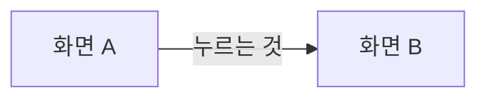

# 화면 흐름

> 이 문서는 {{기능}}의 화면들이 어떤 순서로 이어지는지를 다룬다.

## 화면 목록

<!-- 안내: 색, 위치, 크기는 쓰지 않는다. 무엇이 보이고 무엇을 할 수 있는지만 쓴다. -->

| 앱 | 화면 | 들어오는 길 | 이 화면에서 할 수 있는 일 |
|---|---|---|---|
| (작성 필요) | (작성 필요) | (작성 필요) | (작성 필요) |

## 전체 흐름

