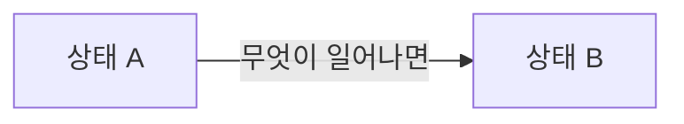

# 상태와 계산 규칙

> 이 문서는 {{기능}}에서 다루는 대상마다 어떤 상태가 있고, 언제 바뀌는지와 숫자를 어떻게 계산하는지를 다룬다.

<!-- 안내: 상태 이름은 일상어로만 쓴다(예: 진행 전, 진행 중, 완료). 영어 대문자 코드값은 쓰지 않는다. 코드값은 2단계 개발 설계에서 정한다. 대상마다 "## 대상 이름" 절을 하나씩 만든다. -->

## (작성 필요: 대상 이름)

| 상태 | 언제 이 상태가 되나 | 이 상태에서 달라지는 것 |
|---|---|---|
| (작성 필요) | (작성 필요) | (작성 필요) |

## 계산 규칙

<!-- 안내: 계산할 값이 없으면 "이번 기획에는 계산할 값이 없다."라고 쓴다. 화면마다 소수점 처리(반올림, 버림)가 다르면 표에 함께 쓴다. -->

| 값 | 계산 방법 | 예시 | 화면에 보이는 형태 |
|---|---|---|---|
| (작성 필요) | (작성 필요) | (작성 필요) | (작성 필요) |
